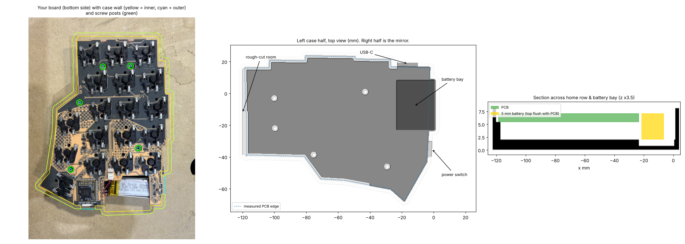

# 36-key Corne tray case (Boardsource Wireless Corne SMT v1.01, Choc v2 + MX keycaps)

Low-profile tray for the Boardsource board with the outer pinky column broken off.

* **Board geometry is measured from a photo** of the actual PCB (`boardsource_outline.json`), scaled with
  the 19.05 mm key grid (fit error ~0.15 mm at the keys, ~0.3-0.5 mm at the edges).
  The Boardsource outline and screw holes differ from the standard crkbd ones.
* **Print `corne36_fit_test_pair.3mf` first** (0.8 mm frame, ~10 min): lay the PCB on it bottom-side down,
  check that the edge sits inside the rim and that M2 screws drop through the PCB holes into the ring holes.
* Case: `corne36_case_pair.3mf` (left + right). Print floor-down, no supports. ~32 g PLA per half.
  * 5 posts at the board's M2 holes, 1.7 mm pilot for M2 self-tapping screws (6 mm). `screw_d=3.2` for heat inserts.
  * 0.7 mm clearance; 1 mm extra room along the broken-off edge.
  * 3.5 mm under the PCB for sockets and the nRF module; battery bay under the battery window goes 1.2 mm deeper.
  * Openings for USB-C (top edge of the controller strip) and the power slide switch (inner edge).
  * Wall rises 1.2 mm above the PCB top; keycaps clear it bottomed out.
  * Five 10 x 0.8 mm recesses for rubber feet.

Regenerate after editing `P` in `corne36_case.py` (needs numpy, scikit-image, matplotlib):

    python3 corne36_case.py boardsource_outline.json out
