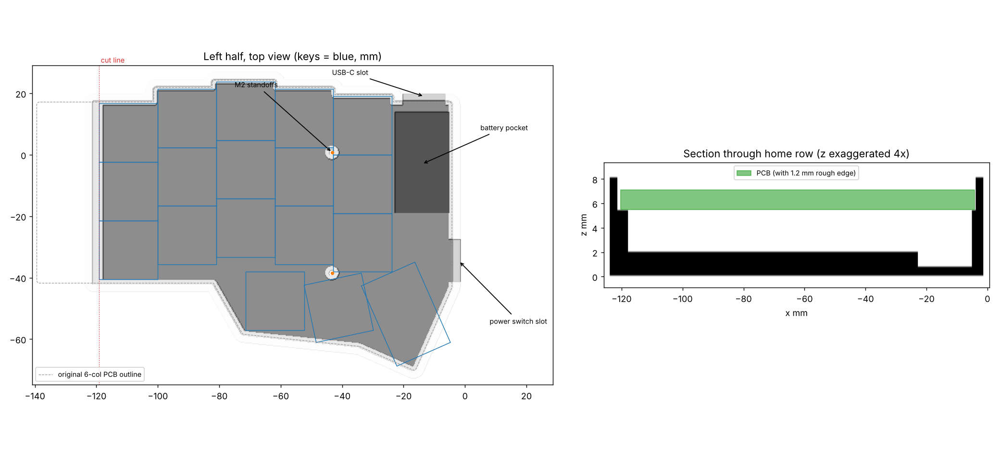

# 36-key Corne tray case (Choc v2 + MX keycaps)

Low-profile tray for the Boardsource Wireless Corne SMT with the outer pinky column cut off.
`corne36_case_pair.3mf` has both halves; print floor-down, no supports needed.

* Outline: standard crkbd (foostan) PCB outline, clipped at the column 0/1 boundary (`cut_x`).
* Cut side has 2 mm extra room (`cut_extra`) plus a ledge, so a rough cut is hidden behind the wall.
* PCB rests on a 1 mm perimeter ledge and two M2 standoffs (the two outer holes were lost in the cut).
  Pilot hole 1.7 mm for M2 self-tapping screws from the top; set `screw_d=3.2` for heat-set inserts.
* 3.5 mm under the PCB for hotswap sockets; 1.2 mm extra battery pocket under the controller area.
* Wall rises 1.2 mm above the PCB top (keycaps clear it even bottomed out).
* Openings: USB-C on the top edge of the controller area, power switch on the inner edge
  (where wired Cornes have the TRRS jack). **Check these against your board** before printing.
* Five 10 mm × 0.8 mm recesses for rubber feet.

Regenerate after changing the `P` dict in `corne36_case.py` (needs numpy, scikit-image, matplotlib):

    python3 corne36_case.py crkbd_outline.json out
