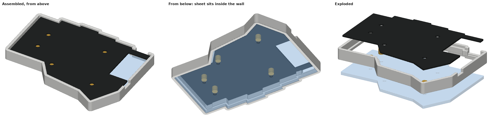

# 36-key Corne case (Boardsource Wireless Corne SMT v1.01, Choc v2 + MX keycaps)

Printed frame + laser-cut acrylic bottom for the Boardsource board with the outer pinky column broken off.
**One half only:** the board is symmetric, so print the frame once as-is and once mirrored in the slicer.
The acrylic is flat, so cut the same file twice and flip one sheet over for the right side.

**How it goes together (per half):**
the PCB drops into the frame from the top and rests on the printed lip, as before. The acrylic sheet fits inside
the wall from below, flush with the frame bottom, and stops against the underside of the lip plus a 1 mm strip
round the inside of the wall (outside the board footprint, clear of the sockets). Five M3 standoffs stand
between the sheet and the PCB at the mounting holes. At the two roomy holes (below the middle column and
between the thumb keys) an M3 screw comes down through the PCB into the standoff and another comes up
through the sheet into the same standoff. That pulls the board onto the lip and the sheet up against the lip and strip.
The other three standoffs are screwed to the sheet and just support the board (the switches leave no room for screw heads there).

**Hardware per half:**
* 5x M3 x 5 mm female-female standoff (round, 5 mm OD)
* 5x M3 x 5 screw, up through the acrylic (2 mm into the standoff)
* 2x M3 x 4 pan-head screw, down through the PCB (M3 x 5 if you fit the top cover)
* 4 or 5 stick-on rubber feet on the acrylic

5 mm standoffs rather than 4 so the screws from both ends don't meet in the clamp standoffs.

**Files:**
* `corne36_acrylic_3mm.dxf` / `.svg` (laser cutting): 3 mm acrylic, cut 2. One closed outline + five 3.2 mm holes,
  millimetres, real size, on a red hairline. The outline is the board grown by 0.5 mm, so it drops into the wall
  with 0.2 mm all round. ~118 x 93 mm.
* `corne36_case_half.3mf` (the frame): ~123 x 98 x 10.8 mm. Print it upright (open bottom on the bed),
  no supports: the lip only overhangs ~1.7 mm inward from the wall. Wall 2.4 mm; 0.7 mm clearance to the
  board edge, 1 mm extra along the broken-off edge, no lip on that edge (its hotswap sockets reach the board edge).
  The wall rises 1.2 mm above the PCB top. Openings for USB-C and the power switch.
* `corne36_fit_test_half.3mf`: a 0.8 mm frame to check the outline and hole positions before printing the full frame
  (lower the PCB onto it; the pins should drop into the holes).

**Stack:** 3 mm acrylic, 5 mm under the PCB for sockets and the nRF module, 1.6 mm PCB, 1.2 mm wall above:
10.8 mm total. The battery (301230) sits on top of the PCB under the nice!view, so it needs no space in the case.

* **Board outline** is a clean polygon (straight edges, square column steps, straight cut and inner edges);
  each edge position is measured from Boardsource's two high-res product photos (~7.7 px/mm, scaled with the
  19.05 mm key grid). The cut edge sits on the breakaway mouse-bite line; the USB-C shell and power-switch nub
  are left out of the outline (the case has openings for them). Mounting holes, USB-C and power switch are
  measured from the same photos (`tools/clean_outline.py`, `tools/outline_hires2.py`).
  `case_on_boardsource_photos.png` shows the case drawn over both photos; `tools/` has the extraction
  scripts (point them at the two photos).
* **Top cover** `corne36_cover_half.3mf` (optional): a 1 mm plate that lies on the PCB inside the wall and hides
  the board between the keys. 15.6 mm square cutouts around every switch (thumbs at 0 / 15 / 30 degrees), open
  over the controller strip (USB-C, display + battery, power switch, reset) with a channel for the battery wires.
  The two top M3 screws go through it (3.4 mm holes), so they clamp cover + PCB together; no features narrower than 1.2 mm.
  Pull the switches, lay the cover on the PCB, push the switches back in. ~3 g PLA, prints flat.
  `cover_on_top_photo.png` shows it over Boardsource's top-side photo.

Regenerate after editing `P` in `corne36_case.py` (needs numpy, scikit-image, matplotlib):

    python3 corne36_case.py boardsource_outline.json out

`acrylic_t` and `standoff_h` set the sheet thickness and the gap under the PCB. `bottom='floor'` gives the
earlier all-printed tray instead (printed floor, locating pins and M2 screws, `preview.png`).
